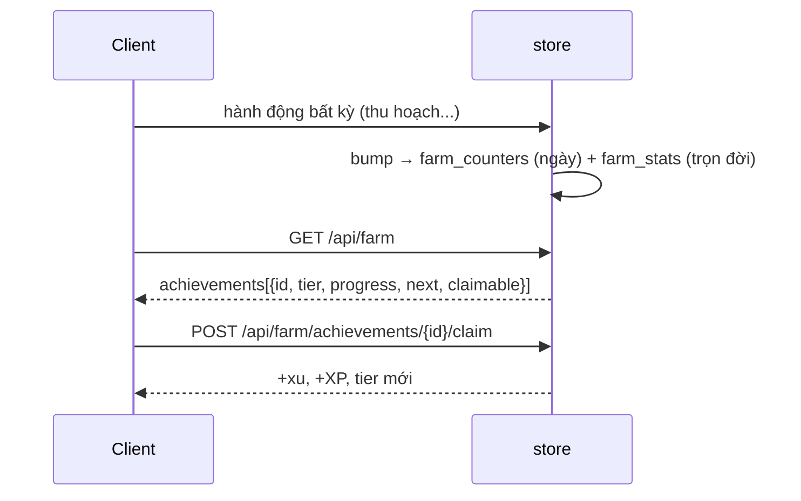

# Đặc tả kỹ thuật (SPEC): Nông trại — Thành tích & Trang trí

Tài liệu này mô tả **Thành tích**, gồm huy hiệu nhiều bậc và thưởng một lần, và **Đồ trang trí**: mua đồ,
đặt lên bản đồ, tính điểm đẹp.

---

## 1. Mục tiêu & Phạm vi

### 1.1. Bối cảnh
- Cấp không giới hạn, nhưng các mốc mở khoá chỉ đến khoảng cấp 18. Người chơi lâu năm thiếu mục tiêu
  dài hạn để khoe với bạn bè.
- Xu dồn lại ngày càng nhiều mà chưa có chỗ tiêu chỉ để "cho đẹp".

### 1.2. Mục tiêu chính
- [ ] **Thành tích** theo bậc 🥉 Đồng, 🥈 Bạc, 🥇 Vàng, đếm hành động **tích luỹ trọn đời**. Đạt bậc thì
  bấm nhận thưởng xu và XP.
- [ ] **Huy hiệu**: người chơi chọn tối đa 3 huy hiệu đã đạt để hiện cạnh tên trong danh sách hàng xóm
  và trên vườn của mình.
- [ ] **Đồ trang trí**: mua ở tab "Trang trí", đặt hoặc dời trên bản đồ như công trình, bán lại được
  50% giá. Mỗi món có **điểm đẹp**. Tổng điểm đẹp hiện cho người ghé thăm.

### 1.3. Ngoài phạm vi / anti-goal
- Đồ trang trí **không có tác dụng lên sản xuất** (thời gian, sản lượng, giá). Nó chỉ để ngắm, để tránh
  "trả tiền để mạnh hơn".
- Không có thành tích ẩn, không có thành tích theo mùa ở bản đầu.
- **Anti-goal:**
  - thưởng thành tích đủ lớn để tạo vòng lặp có lãi;
  - mua rồi bán lại đồ trang trí có lời;
  - đồ trang trí đè lên ruộng hoặc vườn.

---

## 2. Kiến trúc & Luồng hoạt động

- **Thống kê trọn đời:** `op.bump(userID, key, n)` hiện chỉ ghi `farm_counters` theo ngày. Sửa để mỗi
  lần bump cũng `INSERT … ON CONFLICT DO UPDATE total = total + n` vào `farm_stats`. Mọi chỗ đang
  bump sẽ tự được đếm.
- Một số khoá bump mới được thêm ở chỗ chưa có: `craft` (mỗi món nấu/ép xong khi thu), `fruit` (số quả
  hái), `order` (số đơn giao), `feed` (số con cho ăn).
- Thành tích **không cần job nền**. Mỗi lần dựng `FarmView`, đọc `farm_stats` và `farm_achievements`
  rồi tính bậc đã đạt nhưng chưa nhận.
- Đồ trang trí dùng lại hệ toạ độ và kiểm tra va chạm của công trình (`store/farm_place.go`, gồm
  `FarmBlocked` và các công trình đã đặt).



---

## 3. Mô hình dữ liệu & API

### 3.1. SQLite (migration `000035_farm_achievements_decor`)
```sql
CREATE TABLE farm_stats (
  user_id INTEGER NOT NULL REFERENCES users (id) ON DELETE CASCADE,
  key     TEXT    NOT NULL,
  total   INTEGER NOT NULL DEFAULT 0,
  PRIMARY KEY (user_id, key)
);
CREATE TABLE farm_achievements (
  user_id INTEGER NOT NULL REFERENCES users (id) ON DELETE CASCADE,
  id      TEXT    NOT NULL,
  tier    INTEGER NOT NULL,      -- bậc đã nhận: 1 đồng, 2 bạc, 3 vàng
  at      INTEGER NOT NULL,
  PRIMARY KEY (user_id, id)
);
ALTER TABLE farms ADD COLUMN badges TEXT NOT NULL DEFAULT '';  -- tối đa 3 id, phân tách bằng dấu phẩy
CREATE TABLE farm_decor (
  id      INTEGER PRIMARY KEY AUTOINCREMENT,
  user_id INTEGER NOT NULL REFERENCES users (id) ON DELETE CASCADE,
  kind    TEXT    NOT NULL,
  x       INTEGER NOT NULL,
  y       INTEGER NOT NULL
);
```

**Dữ liệu cũ:** lúc migrate, khởi tạo `farm_stats` từ những gì đã có:
- `harvest`, `plant`, … cộng từ `farm_counters` (tổng mọi ngày còn lưu);
- `level` lấy từ cấp hiện tại.

Dữ liệu cũ không đủ là chấp nhận được, chỉ ghi rõ trong ghi chú phát hành.

### 3.2. Danh mục thành tích (`Achievements`)
| id | Tên | Đếm (`farm_stats.key`) | 🥉 | 🥈 | 🥇 |
|---|---|---|---|---|---|
| `harvest` | Nhà nông chăm chỉ | harvest | 100 | 1 000 | 10 000 |
| `plant` | Gieo hạt không ngừng | plant | 100 | 1 000 | 10 000 |
| `helper` | Hàng xóm tốt bụng | water + bug | 30 | 300 | 3 000 |
| `thief` | Siêu trộm | steal | 20 | 200 | 1 000 |
| `chef` | Đầu bếp | craft | 30 | 300 | 3 000 |
| `fruit` | Vua trái cây | fruit | 200 | 2 000 | 20 000 |
| `trucker` | Giao hàng tận tâm | order | 20 | 200 | 1 000 |
| `rancher` | Chủ trại | feed | 100 | 1 000 | 10 000 |
| `level` | Lão nông | level (giá trị lớn nhất) | 10 | 20 | 30 |
| `beauty` | Vườn đẹp | điểm đẹp hiện tại | 50 | 200 | 500 |
| `lover` | Tình sâu nghĩa nặng | cấp thân mật | 3 | 6 | 9 |

- Thưởng: Đồng 100 xu + 20 XP, Bạc 500 xu + 80 XP, Vàng 2 000 xu + 300 XP. Mỗi bậc chỉ nhận một lần.
- Không tạo vòng lặp có lãi, vì thưởng là một lần cho mỗi bậc.
- Có 11 thành tích, mỗi cái 3 bậc. Tổng thưởng tối đa khoảng 28 600 xu cho cả đời chơi.

### 3.3. Danh mục trang trí (`Decor`)
| id | Tên | emoji | Kích thước | Giá | Điểm đẹp | Cấp |
|---|---|---|---|---|---|---|
| `hoa` | Bồn hoa | 🌷 | 1×1 | 80 | 3 | 3 |
| `hang_rao` | Hàng rào gỗ | 🪵 | 1×1 | 50 | 1 | 3 |
| `den` | Đèn lồng | 🏮 | 1×1 | 150 | 5 | 6 |
| `ghe` | Ghế đá | 🪑 | 2×1 | 250 | 8 | 8 |
| `bu_nhin` | Bù nhìn | 🎎 | 1×1 | 300 | 10 | 10 |
| `xich_du` | Xích đu | 🛝 | 2×2 | 800 | 25 | 12 |
| `coi_xay` | Cối xay gió | 🌬️ | 2×2 | 1 500 | 45 | 15 |
| `dai_phun` | Đài phun nước | ⛲ | 2×2 | 3 000 | 90 | 20 |
| `tuong` | Tượng vàng | 🗿 | 1×1 | 6 000 | 160 | 25 |

- Tối đa **30 món** trên một vườn. Bán lại được `⌊giá/2⌋`. Không có quan hệ mua–bán nào tạo lãi.
- Điểm đẹp = tổng điểm các món. Danh hiệu theo mốc: < 50 "Mộc mạc", 50 "Xinh xắn", 200 "Thơ mộng",
  500 "Tuyệt tác".

### 3.4. REST
```
POST   /api/farm/achievements/{id}/claim        -> FarmView (gained.xu/xp)
PUT    /api/farm/badges        {ids: string[≤3]} -> FarmView
POST   /api/farm/decor         {kind, x, y}      -> FarmView
PATCH  /api/farm/decor/{id}    {x, y}            -> FarmView
DELETE /api/farm/decor/{id}                      -> FarmView (bán lại 50%)
```
- `FarmView` thêm `achievements[]` (chỉ chủ vườn), `badges: string[]` (ai cũng thấy), `decor[]` (ai cũng
  thấy), `decor_kinds[]`, `beauty: {score, title}`.
- `neighbors[]` thêm `badges` và `beauty`.

---

## 4. Quy tắc nghiệp vụ & Trường hợp biên

| Tình huống | Xử lý |
|---|---|
| Nhận bậc khi chưa đủ | `ErrFarmAchNotReady` ("Chưa đạt mốc này.") |
| Đạt nhiều bậc cùng lúc (dữ liệu cũ) | Nhận lần lượt từng bậc, mỗi lần bấm một bậc |
| `beauty` giảm vì bán đồ | Bậc đã nhận vẫn giữ. Tiến độ hiện theo điểm hiện tại |
| Huy hiệu chọn chưa đạt | `ErrFarmBadgeLocked` |
| Đặt đồ chồng lên ruộng, chuồng, vườn cây, công trình hay đồ khác | Dùng lại `spotProblem`, báo cùng lỗi như khi đặt công trình |
| Đã có 30 món | `ErrFarmDecorMax` ("Vườn đã có đủ 30 món trang trí.") |
| Đồ trang trí với `/auto` và người làm thuê | Không liên quan |
| Hàng xóm xem vườn | Thấy đồ trang trí, huy hiệu, điểm đẹp. Không tương tác được |
| Trộm, chó | Không ảnh hưởng đồ trang trí |

---

## 5. Thiết kế giao diện

- **Tab mới "🏆 Thành tích"**, danh sách thẻ:
  ```
  🧺 Nhà nông chăm chỉ   🥈  ████████░░ 812 / 1000   Thưởng: 500 xu   [Nhận] (khi đủ)
  ```
  Có ô chọn tối đa 3 huy hiệu để hiện. Có chấm đỏ trên tab khi có bậc nhận được.
- **Tab mới "🎨 Trang trí"**:
  - cửa hàng đồ trang trí, khoá theo cấp;
  - bấm "Mua" thì vào chế độ đặt chỗ, dùng lại `startPlacing` của công trình;
  - danh sách đồ đã đặt, mỗi món có nút Dời và Bán.
- **FarmWorld:** vẽ đồ trang trí bằng emoji trên đế isometric, như cách vẽ đồ vật hiện có.
- **Danh sách hàng xóm:** tên kèm 1–3 emoji huy hiệu và "✨ 230".
- **Toast** khi đạt bậc mới, phát hiện bằng cách so view cũ với view mới:
  "🏆 Đạt 🥈 Nhà nông chăm chỉ! Vào Thành tích để nhận thưởng".

---

## 6. Thống kê / Bảng xếp hạng

`farm_stats` là nguồn dữ liệu cho bảng xếp hạng ở spec sự kiện tuần (`FARM_WEEKLY_EVENTS_SPEC.md`).

---

## 7. Kế hoạch triển khai

- [ ] Migration `000035`, khởi tạo `farm_stats` từ dữ liệu cũ, test up/down.
- [ ] Store, thống kê và thành tích:
  - [ ] ghi `farm_stats` trong `bump`;
  - [ ] thêm các khoá bump mới (craft, fruit, order, feed);
  - [ ] danh mục thành tích, tính bậc trong view, nhận thưởng;
  - [ ] huy hiệu;
  - [ ] test.
- [ ] Store, trang trí:
  - [ ] danh mục, mua, đặt, dời, bán lại;
  - [ ] giới hạn 30 món, kiểm tra va chạm;
  - [ ] điểm đẹp và danh hiệu;
  - [ ] test không có lãi.
- [ ] Controller: route, test.
- [ ] Desktop:
  - [ ] tab Thành tích;
  - [ ] tab Trang trí, chế độ đặt chỗ;
  - [ ] vẽ đồ trên FarmWorld;
  - [ ] huy hiệu và điểm đẹp ở danh sách hàng xóm;
  - [ ] toast.
- [ ] Cập nhật `specs/FARM_SPEC.md` (§18), `specs/README.md`.
