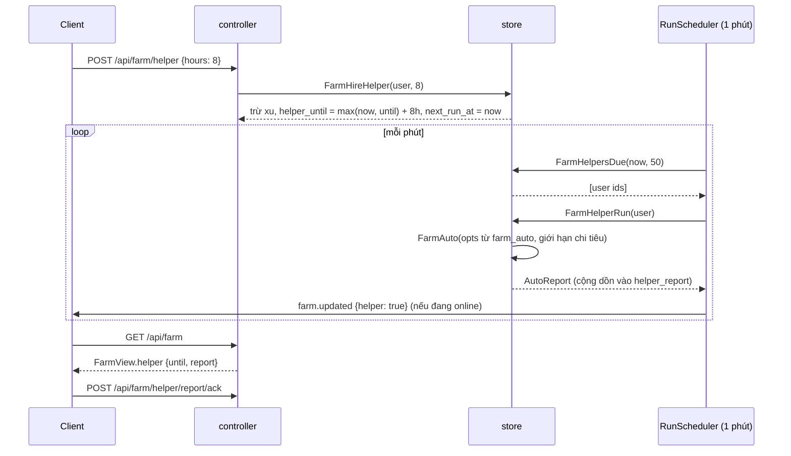

# Đặc tả kỹ thuật (SPEC): Nông trại — Người làm thuê (tự động khi tắt app)

Tài liệu này mô tả tính năng **Người làm thuê** của nông trại `tidebird/chat`: kiến trúc, dữ liệu,
luật nghiệp vụ và kế hoạch triển khai. Tính năng xây trên phần "⚡ Làm hết / 🤖 Tự động"
(`specs/FARM_SPEC.md` §14, PR #13–#15).

---

## 1. Mục tiêu & Phạm vi (Goals & Scope)

### 1.1. Bối cảnh & vấn đề
- "🤖 Tự động" chỉ chạy khi app đang mở, vì vòng lặp 30 giây nằm ở client. Người chơi tắt máy là cây
  chín nằm chờ, vật nuôi đói và lò để trống.
- Vì vậy thời gian hoàn vốn thực tế dài hơn nhiều so với lý thuyết. Ví dụ cây xoài: lý thuyết 12h,
  thực tế 1–1.5 ngày.
- Cấp không giới hạn làm xu ngày càng dồn lại. Game cần chỗ tiêu xu có ích.

### 1.2. Mục tiêu chính
- [ ] Người chơi **thuê người làm** theo gói giờ và trả bằng xu. Trong thời gian thuê, **server** tự
  chạy `FarmAuto` định kỳ với cài đặt tự động của người chơi, kể cả khi app đã đóng.
- [ ] Cài đặt tự động chuyển lên server (bảng `farm_auto`), để server biết gieo cây gì, nấu món gì và có
  được mua thức ăn hay không.
- [ ] Khi mở lại nông trại, người chơi thấy **báo cáo "Trong lúc bạn vắng"**.

### 1.3. Ngoài phạm vi / anti-goal
- Không thuê người làm cho vườn người khác. Không có người làm miễn phí.
- **Anti-goal:**
  - người làm tiêu xu quá mức người chơi cho phép;
  - người làm đẩy người chơi vào nợ;
  - server bị quá tải khi nhiều người cùng thuê;
  - một lượt chạy làm khoá DB lâu.

---

## 2. Kiến trúc & Luồng hoạt động

- `RunScheduler` (`controller/reminders.go`) đã có ticker. Thêm một bước `a.farmHelpers(ctx, now)` chạy
  **mỗi phút**.
- Mỗi lần chạy lấy tối đa **50** người có `helper_until > now AND next_run_at <= now`, sắp theo
  `next_run_at`. Với mỗi người, gọi `store.FarmHelperRun(ctx, userID, now)`.



- Mỗi lượt chạy là **một `farmTx` riêng cho từng người**, vì `FarmAuto` đã là một giao dịch với
  savepoint cho từng bước. Không gom nhiều người vào một giao dịch.
- Sau mỗi lượt chạy: `next_run_at = now + 30 phút`. Lượt nào lỗi DB thì ghi log, đặt
  `next_run_at = now + 5 phút` rồi bỏ qua người đó.

---

## 3. Mô hình dữ liệu & API

### 3.1. SQLite (migration `000036_farm_auto`)
```sql
CREATE TABLE farm_auto (
  user_id        INTEGER PRIMARY KEY REFERENCES users (id) ON DELETE CASCADE,
  crop           TEXT    NOT NULL DEFAULT '',
  kitchen_recipe TEXT    NOT NULL DEFAULT '',
  juicer_recipe  TEXT    NOT NULL DEFAULT '',
  buy_feed       INTEGER NOT NULL DEFAULT 0,
  spend_cap      INTEGER NOT NULL DEFAULT 300,  -- xu tối đa người làm được tiêu mỗi lượt
  helper_until   INTEGER NOT NULL DEFAULT 0,    -- unix giây
  next_run_at    INTEGER NOT NULL DEFAULT 0,
  report         TEXT    NOT NULL DEFAULT ''    -- JSON AutoReport cộng dồn, '' = chưa có
);
CREATE INDEX farm_auto_due ON farm_auto (next_run_at) WHERE helper_until > 0;
```
Số migration lấy theo số kế tiếp lúc làm. Hiện đang là 000033, các spec khác trong đợt này có thể dùng
trước số 000034 và 000035.

### 3.2. Go
```go
type HelperPlan struct { Hours int; Price int64 }          // gói thuê, giá theo cấp
func helperPrice(level int, hours int) int64               // (10 + 2*level) * hours
var HelperHours = []int{8, 24}
const HelperMaxAhead = 72 * time.Hour
const HelperEvery = 30 * time.Minute

func (s *Store) FarmAutoSettings(ctx, userID) (AutoSettings, error)
func (s *Store) FarmSaveAutoSettings(ctx, userID, AutoSettings) (FarmResult, error)
func (s *Store) FarmHireHelper(ctx, userID int64, hours int) (FarmResult, error)
func (s *Store) FarmHelpersDue(ctx, now time.Time, limit int) ([]int64, error)
func (s *Store) FarmHelperRun(ctx, userID int64, now time.Time) (AutoReport, error)
func (s *Store) FarmHelperAck(ctx, userID int64) error      // xoá report
```
- `AutoOpts` có thêm trường `SpendCap int64`. Khi `> 0`, mọi lần `op.spend` trong `FarmAuto` (hạt
  giống, thức ăn) cộng dồn vào một bộ đếm. Nếu khoản tiêu tiếp theo làm vượt trần, bước đó trả
  `ErrFarmSpendCap`, bị ghi vào Skipped "Đã chạm hạn mức chi" rồi bỏ qua.
- Khi người chơi bấm "⚡ Làm hết", `SpendCap = 0` nghĩa là không giới hạn, giữ nguyên như hiện tại.

### 3.3. REST
```
GET  /api/farm/auto/settings                -> AutoSettings
PUT  /api/farm/auto/settings  {crop, kitchen_recipe, juicer_recipe, buy_feed, spend_cap} -> FarmView
POST /api/farm/helper         {hours: 8|24} -> FarmView (gained.xu âm)
POST /api/farm/helper/report/ack            -> 204
```
`FarmView` có thêm trường sau, **chỉ khi xem vườn của mình**:
```ts
helper?: {
  until: string | null;
  plans: { hours: number; price: number }[];
  report?: AutoReport & { runs: number; from: string; to: string };
};
```
WebSocket: sau mỗi lượt chạy có việc, gửi `farm.updated {helper: true}` tới chủ vườn, không kèm log.

---

## 4. Quy tắc nghiệp vụ & Trường hợp biên

| Tình huống | Xử lý |
|---|---|
| Thuê khi đang có người làm | Cộng dồn thời gian: `until = max(now, until) + hours`. Nếu vượt `now + 72h` thì báo `ErrFarmHelperMax` ("Người làm đã được thuê đủ 72 giờ.") |
| Không đủ xu | `ErrInsufficientBalance`, không thuê được. Chỉ trả bằng xu đang có, **không vay** |
| Cấp < 5 | Chưa mở tính năng: `ErrFarmLevel` ("Cần cấp 5 để thuê người làm."). Lý do: cấp thấp ít việc, tránh phí xu |
| Huỷ thuê | Không có. Không hoàn tiền; UI ghi rõ khi xác nhận |
| Đang nợ | Thuê được. Xu kiếm được khi người làm bán hàng đi qua `earn`, nên tự trừ 50% vào nợ như luật cũ |
| Lượt chạy không có việc (`ErrFarmNothingAuto`) | Bình thường. Không tính vào báo cáo, `next_run_at += 30 phút` |
| Lượt chạy hết xu giữa chừng | Bước đó vào Skipped "Không đủ xu.". Các bước không tốn xu vẫn chạy |
| Trần chi tiêu `spend_cap` | Áp cho **mỗi lượt**, từ 0 đến 5000. Bằng 0 nghĩa là người làm không bao giờ tiêu xu: không gieo hạt, không mua thức ăn |
| Server tắt hoặc khởi động lại | `next_run_at` được lưu trong DB. Khi bật lại sẽ chạy bù **một** lượt (không chạy bù nhiều lượt đã lỡ) |
| Hết hạn thuê | Không chạy nữa. Báo cáo vẫn giữ tới khi người chơi xem (ack) |
| Người chơi đang mở app và bật "🤖 Tự động" | Cả hai cùng chạy được. Mọi thay đổi đi qua `farmTx` nên không ghi đè lẫn nhau. Client nhận `farm.updated` thì tải lại view |
| Cài đặt chọn cây chưa đủ cấp hoặc công thức chưa mở | Bước đó vào Skipped (lý do lấy từ lỗi nghiệp vụ). Không chặn lúc lưu cài đặt |
| Hơn 50 người cùng tới hạn | Phút sau làm tiếp. `next_run_at` nhỏ nhất được làm trước nên không ai bị bỏ đói |
| Báo cáo cộng dồn | Cộng từng trường số, `skipped` giữ 10 lý do gần nhất, `runs` đếm số lượt có việc |

**Giá:** `(10 + 2 × cấp) × giờ` xu. Ví dụ: cấp 11, gói 8h là 256 xu; cấp 11, gói 24h là 768 xu;
cấp 30, gói 24h là 1680 xu. So với sản lượng ở mỗi cấp (một lần hái xoài ở cấp 11 được 288 xu), gói 24h
chỉ có lời khi vườn đủ lớn. Đây là chủ đích: tính năng này là chỗ tiêu xu cho người chơi lâu năm.

---

## 5. Thiết kế giao diện (UI / UX)

- Popover ⚙️ của "🤖 Tự động" có thêm hai mục:
  - Ô **"Hạn mức chi mỗi lượt"**, mặc định 300 xu.
  - Thẻ **"🧑‍🌾 Người làm thuê"**:
    ```
    🧑‍🌾 Người làm thuê            Đang làm đến 18:30 (còn 5 giờ)
    [ Thuê 8 giờ — 256 xu ]  [ Thuê 24 giờ — 768 xu ]
    Người làm chạy "Làm hết" 30 phút một lần, kể cả khi bạn tắt app.
    ```
- Cài đặt lưu **trên server**:
  - Lần đầu mở bản mới, client đọc `localStorage farm-auto:<id>` rồi `PUT` lên server một lần.
  - Công tắc `on` của vòng lặp client vẫn lưu ở localStorage, vì nó chỉ có nghĩa với máy đang mở app.
- Khi mở nông trại mà `helper.report` có dữ liệu, hiện hộp thoại **"Trong lúc bạn vắng"** (từ `from`
  tới `to`), dùng lại `autoSummary`:
  "🧑‍🌾 Bắt 3 sâu, thu 24 ô, gieo 24, tưới 24 ô, cho 8 con ăn, hái 30 quả, thu 6 món, nấu 6 món,
  tiêu 410 xu".
  Bấm "Tuyệt" thì gọi `ack`.
- Trên bản đồ, khi đang thuê, cạnh nhà có một nhân vật 🧑‍🌾 nhỏ.

---

## 6. Thống kê

Không có bảng xếp hạng. `wallet_tx` ghi chú "Thuê người làm 8 giờ" để người chơi tra lịch sử chi.

---

## 7. Kế hoạch triển khai

- [ ] Migration `farm_auto` (up/down) và test.
- [ ] Store:
  - [ ] cài đặt tự động (đọc/lưu, kiểm tra hợp lệ);
  - [ ] `SpendCap` trong `FarmAuto`, có test cho trường hợp chạm trần;
  - [ ] `FarmHireHelper`: giá, cộng dồn, giới hạn 72h, khoá dưới cấp 5;
  - [ ] `FarmHelpersDue`;
  - [ ] `FarmHelperRun`: cộng dồn báo cáo, chạy bù một lượt, lượt không có việc;
  - [ ] `FarmHelperAck`.
- [ ] Controller:
  - [ ] các route mới;
  - [ ] gắn `farmHelpers` vào `RunScheduler` (mỗi phút, tối đa 50 người);
  - [ ] gửi `farm.updated {helper:true}`;
  - [ ] test.
- [ ] Desktop:
  - [ ] chuyển cài đặt từ localStorage lên server;
  - [ ] ô hạn mức chi;
  - [ ] thẻ người làm thuê;
  - [ ] hộp thoại "Trong lúc bạn vắng";
  - [ ] nhân vật 🧑‍🌾 trên bản đồ.
- [ ] Cập nhật `specs/FARM_SPEC.md` (thêm §15) và `specs/README.md`.
