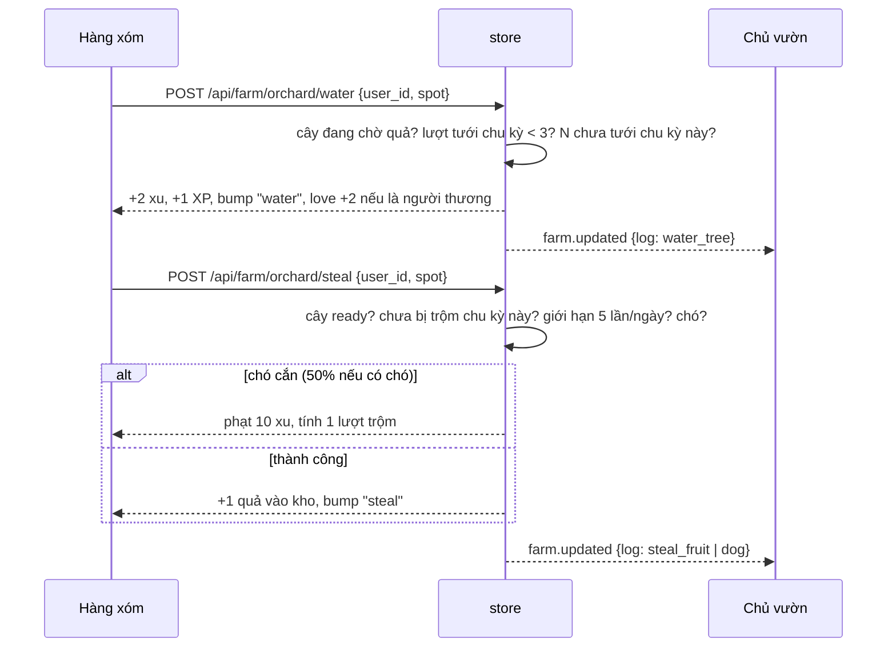

# Đặc tả kỹ thuật (SPEC): Nông trại — Hàng xóm & Vườn cây ăn quả, Đơn hàng đôi

Tài liệu này mô tả phần **xã giao cho vườn cây ăn quả**: tưới cây giúp, trộm quả, chó canh vườn cây.
Kèm theo là **Đơn hàng đôi** cho các cặp đã kết đôi. Phần 5 (`FARM_SPEC.md` §12) đã cố ý để lại các
việc này cho phần sau.

---

## 1. Mục tiêu & Phạm vi

### 1.1. Bối cảnh
- Ô ruộng có đủ vòng xã giao: tưới giúp, bắt sâu, trộm, chó canh, điểm thân mật. Vườn cây ăn quả thì
  chỉ chủ vườn đụng được, hàng xóm ghé thăm chẳng có gì để làm.
- Kết đôi (Phần 4) chỉ có tặng quà và điểm thân mật. Chưa có việc gì hai người **làm chung**.

### 1.2. Mục tiêu chính
- [ ] Hàng xóm **tưới cây ăn quả** giúp: rút ngắn chu kỳ, được thưởng nhỏ, tính vào nhiệm vụ "water".
- [ ] Hàng xóm **trộm quả** khi cây có quả. Có giới hạn, có chó canh, không trộm được vườn người thương.
- [ ] **Đơn hàng đôi**: mỗi ngày mỗi cặp có một đơn, mỗi người góp phần của mình. Đủ cả hai phần thì cả
  hai cùng nhận thưởng và điểm thân mật.
- [ ] Chủ vườn tự tưới cây ăn quả của mình được 1 lần mỗi chu kỳ. "💧 Tưới tất cả" và `/auto` tưới cả
  cây ăn quả.

### 1.3. Ngoài phạm vi / anti-goal
- Không làm đơn hàng nhóm cho hơn 2 người. Không cho hàng xóm hái quả hộ.
- **Anti-goal:**
  - Trộm quả không được nặng hơn trộm rau: chủ vườn luôn còn ít nhất 1 quả.
  - Đơn hàng đôi không được thành vòng lặp mua ở chợ rồi giao có lãi.
  - Tưới giúp không được spam để cày xu: dùng chung giới hạn với tưới ô ruộng.

---

## 2. Kiến trúc & Luồng hoạt động



- Tưới và trộm quả có **trạng thái theo chu kỳ**: bị xoá khi chủ hái quả, vì hái là sang chu kỳ mới.
- Đơn hàng đôi sinh **lười**: lần đầu một trong hai người mở nông trại trong ngày (VN) thì mới tạo đơn,
  dùng `hash(couple_id, day)` để chọn hàng.

---

## 3. Mô hình dữ liệu & API

### 3.1. SQLite (migration `000034_farm_orchard_social`)
```sql
ALTER TABLE farm_trees ADD COLUMN waters INTEGER NOT NULL DEFAULT 0;
ALTER TABLE farm_trees ADD COLUMN stolen INTEGER NOT NULL DEFAULT 0;
CREATE TABLE farm_tree_acts (               -- ai đã tưới / trộm cây nào trong chu kỳ hiện tại
  tree_id  INTEGER NOT NULL REFERENCES farm_trees (id) ON DELETE CASCADE,
  cycle    INTEGER NOT NULL,                -- = farm_trees.cycles lúc hành động
  actor_id INTEGER NOT NULL,
  action   TEXT    NOT NULL,                -- water | steal
  PRIMARY KEY (tree_id, cycle, actor_id, action)
);
CREATE TABLE farm_couple_orders (
  couple_id   INTEGER NOT NULL REFERENCES farm_couples (id) ON DELETE CASCADE,
  day         TEXT    NOT NULL,
  part_a      TEXT    NOT NULL,             -- JSON [{item, qty}] phần của user_a
  part_b      TEXT    NOT NULL,
  done_a      INTEGER NOT NULL DEFAULT 0,
  done_b      INTEGER NOT NULL DEFAULT 0,
  reward      INTEGER NOT NULL,             -- xu mỗi người
  PRIMARY KEY (couple_id, day)
);
```
Khi hái quả: `waters = 0`, `stolen = 0`, `cycles + 1`. Các dòng act của chu kỳ cũ để nguyên, lệnh dọn
định kỳ sẽ xoá các dòng có `cycle < cycles`.

### 3.2. Luật tính
- **Tưới cây:** cây có `cycles ≥ 0` và đang chờ quả (`now < ready_at`).
  - `ready_at = max(now, ready_at − CycleSec/10)`. Nếu cây chưa ra quả lần nào thì dùng `MatureSec/10`.
  - Mỗi chu kỳ tối đa 3 lượt tưới, mỗi người 1 lượt.
  - Hàng xóm tưới: +2 xu (`FarmHelpWaterXu`), +1 XP, bump "water", love +2 nếu là người thương. Chủ
    vườn tự tưới không có thưởng.
- **Trộm quả:** cây đang `ready`, `stolen = 0`, người trộm không phải chủ và không phải người thương.
  - Dùng chung `FarmStealsPerDay` (5 lần/ngày) và cơ chế chó như trộm rau: 50%, phạt 10 xu.
  - Trộm thành công: người trộm +1 quả (kho phải còn chỗ, không thì `ErrFarmStorageFull`),
    `stolen = 1`, bump "steal".
  - Chủ hái lần sau được `max(1, yield − stolen)`.
- **Đơn hàng đôi:**
  - Mỗi phần có 1–2 món, chọn trong số hàng **người đó tự làm được ở cấp hiện tại**: cây trồng đã mở,
    sản phẩm của vật nuôi đang có, quả của cây đang trồng.
  - Tổng giá gốc mỗi phần nằm trong khoảng 150–400 xu, theo cấp thấp hơn trong hai người.
  - Thưởng mỗi người = `⌊1.3 × tổng giá gốc cả đơn / 2⌋`, cộng 15 XP và **love +5** (chỉ một lần cho
    cả đơn).
  - Mỗi người giao phần của mình bất cứ lúc nào trong ngày. Người giao xong trước thấy dòng "Chờ
    người thương…".
  - Đủ hai phần thì cả hai nhận thưởng ngay, qua `earn`.
- Hệ số 1.3 nhỏ hơn hệ số 1.5 của giá mua ở chợ. Vì vậy mua ở chợ rồi giao không có lãi. Có test chứng
  minh điều này cho mọi món có thể vào đơn.

### 3.3. REST
```
POST /api/farm/orchard/water   {user_id, spot} | {all: true}   -> FarmView
POST /api/farm/orchard/steal   {user_id, spot}                 -> FarmView
POST /api/farm/couple/order/deliver                            -> FarmView
```
- `FarmView.trees[]` có thêm `waters`, `can_water`, `can_steal`, tính theo người đang xem.
- `FarmView.couple.order`:
  ```ts
  { day, mine: Item[], theirs: Item[], done_mine, done_theirs, reward }
  ```
  Chỉ hiện khi xem vườn của mình hoặc của người thương.
- `/api/farm/water {all:true}` (đã có ở PR #14) tưới thêm cả cây ăn quả của chính mình.
  `gained.watered` đếm cả ô ruộng lẫn cây.
- Nhật ký `action` có thêm `water_tree`, `steal_fruit`, `couple_order`.

---

## 4. Quy tắc nghiệp vụ & Trường hợp biên

| Tình huống | Xử lý |
|---|---|
| Tưới cây đang có quả (`ready`) | `ErrFarmTreeNotWaiting` ("Cây đang có quả, hái rồi mới tưới được.") |
| Đã đủ 3 lượt tưới trong chu kỳ | `ErrFarmWaterMax` (dùng lại thông báo cũ) |
| Trộm cây đã bị trộm trong chu kỳ này | `ErrFarmTreeStolen` ("Cây này vừa bị hái trộm rồi.") |
| Trộm vườn người thương | Dùng lại `ErrFarmStealPartner` |
| Kho người trộm đầy | Báo kho đầy. Lượt này **không** tính vào giới hạn trộm trong ngày |
| Chủ chặt cây khi đang có acts | `ON DELETE CASCADE` xoá luôn các dòng act |
| Chia tay khi đơn đôi đang dở | Đơn bị xoá theo `ON DELETE CASCADE`. Ai đã giao thì **được trả lại hàng** vào kho (bỏ phần vượt quá chỗ trống) |
| Một người không đủ hàng | Phần đó chưa giao được. Đơn hết hạn lúc 0h, hàng đã giao không bị mất mà được trả lại (trả lười, khi mở nông trại lần sau) |
| `/auto` | Bước "Tưới" tưới cả cây ăn quả của mình. Không tự giao đơn đôi, vì việc này phải tự tay |
| Thời tiết gió (nếu spec thời tiết đã làm) | Áp sau khi trừ quả bị trộm, tối thiểu vẫn 1 quả |

---

## 5. Thiết kế giao diện

- **Ở vườn hàng xóm:**
  - Cây đang chờ quả mà mình tưới được: hiện bong bóng 💧. Bấm vào thì tưới. Toast "Tưới cây giúp
    hàng xóm 💧".
  - Cây có quả mà mình trộm được: hiện bong bóng 🫳. Bấm vào thì trộm. Toast "Hái trộm 1 🥭" hoặc
    "Bị chó đuổi! −10 xu 🐕".
- **Ở vườn của mình:** cây có biểu tượng 💧 nhỏ khi mình còn tưới được. Bảng "Vườn & Ép" hiện số lượt
  đã tưới ("💧 2/3").
- **Thẻ "💞 Đơn hàng đôi"**, đặt trong tab đơn hàng và trong bảng kết đôi:
  ```
  💞 Đơn hàng đôi hôm nay            Thưởng mỗi người: 390 xu · +5 💗
  Phần của bạn:   🥕×6  🥚×4        [Giao phần của tôi]
  Phần của Lan:   🍓×3  🥛×1        ✅ Đã giao
  ```
- Khi đơn hoàn tất, cả hai nhận toast "Đơn hàng đôi hoàn tất! +390 xu, +5 💗" qua `farm.updated`.

---

## 6. Thống kê

Đếm vào nhiệm vụ hằng ngày có sẵn ("water", "steal"). Không có bảng xếp hạng mới.

---

## 7. Kế hoạch triển khai

- [ ] Migration `000034` (up/down) và test migration.
- [ ] Store, tưới cây:
  - [ ] hàng xóm tưới, chủ tự tưới;
  - [ ] thêm vào `waterAll` và bước `/auto`;
  - [ ] đặt lại khi hái quả;
  - [ ] test.
- [ ] Store, trộm quả:
  - [ ] giới hạn ngày, chó, người thương, kho đầy;
  - [ ] chủ hái `yield − stolen`;
  - [ ] test.
- [ ] Store, đơn hàng đôi:
  - [ ] sinh đơn lười theo hash;
  - [ ] chọn món người đó tự làm được;
  - [ ] giao từng phần, hoàn tất, trả hàng khi chia tay hoặc hết hạn;
  - [ ] test không có lãi khi mua ở chợ.
- [ ] Controller: route mới, nhật ký và `farm.updated`, test.
- [ ] Desktop:
  - [ ] bong bóng 💧/🫳 trên cây ở vườn hàng xóm;
  - [ ] số lượt tưới;
  - [ ] thẻ đơn hàng đôi;
  - [ ] toast.
- [ ] Cập nhật `specs/FARM_SPEC.md` (§17), `specs/README.md`.
