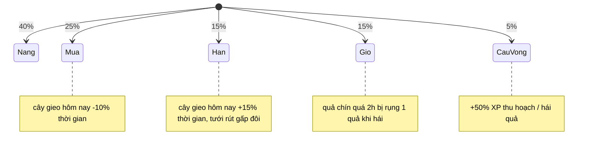

# Đặc tả kỹ thuật (SPEC): Nông trại — Thời tiết & Mùa vụ

Tài liệu này mô tả tính năng **Thời tiết hằng ngày và Mùa theo tuần** cho nông trại `tidebird/chat`.

---

## 1. Mục tiêu & Phạm vi

### 1.1. Bối cảnh & vấn đề
- Ngày nào trong nông trại cũng như ngày nào. Một khi đã chọn được cây lời nhất thì người chơi trồng
  mãi cây đó, bảng cây trồng mất ý nghĩa.
- Chưa có lý do để vào game xem "hôm nay có gì khác".

### 1.2. Mục tiêu chính
- [ ] Mỗi ngày (giờ VN) có **một kiểu thời tiết chung cho mọi người**, để bạn bè có chuyện bàn với nhau.
  Thời tiết đổi nhẹ luật trồng trọt trong ngày đó.
- [ ] Mỗi tuần là **một mùa** (Xuân → Hạ → Thu → Đông). Cây hợp mùa lớn nhanh hơn, nên mỗi tuần có
  lựa chọn tối ưu khác nhau.
- [ ] Xem trước được **dự báo ngày mai**.

### 1.3. Ngoài phạm vi / anti-goal
- Không có thời tiết riêng cho từng người, không có thời tiết theo giờ.
- Không thay đổi hồi tố: cây đã gieo không đổi giờ chín khi trời đổi.
- **Anti-goal:**
  - Không tạo vòng lặp mua ở chợ rồi bán có lãi. Thời tiết **không bao giờ tăng giá bán**.
  - Không trừng phạt nặng, ví dụ mất trắng vụ. Thời tiết xấu chỉ làm chậm hoặc mất ít.
  - Thời tiết phải tính ra được, không lưu trạng thái. Chỉ cần ngày là biết thời tiết, server
    khởi động lại không đổi kết quả.

---

## 2. Kiến trúc & Luồng hoạt động

- Thời tiết là **hàm thuần**: `weatherFor(day string) Weather = pick(hash("weather:" + day))`, chọn theo
  trọng số. Không cần bảng DB.
- Mùa: `seasonFor(t) = Seasons[(isoWeekIndex(t in VN) ) % 4]`. `isoWeekIndex` là số tuần ISO tính từ
  một mốc cố định, mốc chọn sao cho tuần chứa 2026-11-30 là Đông.
- Hiệu ứng áp **tại thời điểm hành động**, giống cách đặc quyền theo cấp đang làm: gieo, tưới, hái
  quả, thu hoạch.



---

## 3. Mô hình dữ liệu & API

### 3.1. Go (`store/farm_weather.go`)
```go
type Weather struct {
  ID    string `json:"id"`    // nang | mua | han | gio | cau_vong
  Name  string `json:"name"`  // Nắng đẹp | Mưa rào | Nắng hạn | Gió lớn | Cầu vồng
  Emoji string `json:"emoji"` // ☀️ 🌧️ 🔥 🌬️ 🌈
  Hint  string `json:"hint"`  // một câu mô tả hiệu ứng, tiếng Việt
}
type Season struct { ID, Name, Emoji string }   // xuan 🌸 | ha ☀️ | thu 🍂 | dong ❄️
func weatherFor(day string) Weather
func seasonFor(t time.Time) Season
func cropInSeason(cropID string, s Season) bool
```
- `Crop` có thêm trường `Season string`:

  | Mùa | Cây |
  |---|---|
  | Xuân | rau_muong, dau_tay |
  | Hạ | ca_chua, ngo, dua_hau |
  | Thu | lua, bi_ngo |
  | Đông | ca_rot, cùng mọi cây có trong code mà bảng chưa liệt kê |

  Cây thêm sau này bắt buộc phải khai báo mùa. Có test kiểm tra không cây nào để trống.

### 3.2. Công thức thời gian gieo
```
pct = grow_pct(cấp) + (hợp mùa ? 20 : 0) + (mưa ? 10 : 0) − (hạn ? 15 : 0)
pct = min(pct, 70)                         // không bao giờ dưới 30% thời gian gốc
ready = now + GrowSec × (100 − pct) / 100
```
- Tưới khi trời hạn: rút `GrowSec/5`, các ngày khác rút `GrowSec/10`.
- Gió lớn: khi hái quả (chủ vườn, kể cả qua `/auto`), một cây có `now − ready_at > 2h` thì rụng
  1 quả, sản lượng = `max(1, yield − 1)`.
- Cầu vồng: XP từ thu hoạch ô và hái quả ×1.5 (làm tròn xuống). Không áp cho XP từ đơn hàng hay
  nấu món.

### 3.3. API
`FarmView` có thêm (ai xem vườn nào cũng thấy):
```ts
weather: { today: Weather; tomorrow: Weather; season: Season; season_ends: string };
```
`crops[]` có thêm `season: string` và `in_season: boolean`.
Không có route mới.

---

## 4. Quy tắc nghiệp vụ & Trường hợp biên

| Tình huống | Xử lý |
|---|---|
| Gieo lúc 23:59, chín sang ngày hôm sau | Dùng thời tiết của **ngày gieo**, không tính lại |
| Đặc quyền cấp + hợp mùa + mưa vượt 70% | Chặn ở 70%. Có test cho cấp 26 (grow 50%) + hợp mùa + mưa |
| Hạn + cấp 1 | pct có thể âm (−15) → thời gian = 115% gốc. Cho phép, đây là hình phạt nhẹ duy nhất |
| Gió lớn, cây chỉ còn yield 1 | Không rụng (tối thiểu 1) |
| Gió lớn với người trộm quả (nếu có từ spec hàng xóm) | Không áp, chỉ áp khi chủ vườn hái |
| `/auto`, người làm thuê | Dùng cùng luật. Người làm thuê chạy mỗi 30 phút nên ít khi bị gió làm rụng quả. Đây là một lợi ích gián tiếp của việc thuê |
| Giá bán | **Không đổi.** Có test: với mọi thời tiết, `FarmSell` trả đúng như ngày nắng |
| Đổi mùa giữa vụ | Không ảnh hưởng cây đã gieo |
| Ngày đổi theo múi giờ | Dùng `vnDay` như nhiệm vụ hằng ngày |

---

## 5. Thiết kế giao diện

- Huy hiệu ở góc trên banner: `☀️ Nắng đẹp · 🍂 Mùa thu (còn 3 ngày)`. Bấm vào mở popover:
  ```
  Hôm nay: 🌧️ Mưa rào — cây gieo hôm nay lớn nhanh hơn 10%.
  Ngày mai: 🔥 Nắng hạn — cây lớn chậm 15%, nhưng tưới hiệu quả gấp đôi.
  Mùa thu: 🌾 Lúa, 🎃 Bí ngô lớn nhanh hơn 20%.
  ```
- Hiệu ứng trên FarmWorld, chỉ bằng SVG và CSS, nhẹ, và tắt theo `prefers-reduced-motion`:
  - mưa: vệt mưa rơi;
  - hạn: tông vàng nóng;
  - gió: lá cây lắc;
  - cầu vồng: cung cầu vồng trên trời.
- Cửa hàng hạt:
  - Cây hợp mùa có nhãn "🍂 Hợp mùa".
  - Thời gian hiển thị đã tính mùa và thời tiết hôm nay, dùng cùng công thức với server, viết trong
    `lib/farm.ts` `effGrowSec`.
- Toast khi mở nông trại lần đầu trong ngày: "Hôm nay 🌧️ Mưa rào: cây gieo hôm nay lớn nhanh hơn 10%".

---

## 6. Thống kê

Không có.

---

## 7. Kế hoạch triển khai

- [ ] `store/farm_weather.go`:
  - [ ] `weatherFor`, `seasonFor`, `Crop.Season`;
  - [ ] test phân phối trọng số trên 10.000 ngày (sai số ±2%);
  - [ ] test tính ra được (cùng ngày thì cùng kết quả);
  - [ ] test không cây nào để trống mùa.
- [ ] Áp hiệu ứng:
  - [ ] lúc gieo, có trần 70%;
  - [ ] lúc tưới khi trời hạn;
  - [ ] lúc hái quả khi gió lớn;
  - [ ] XP cầu vồng;
  - [ ] test cho từng trường hợp, bằng cách cố định ngày giả trong test env.
- [ ] Test giá bán không đổi theo thời tiết.
- [ ] `FarmView.weather`, `crops[].season/in_season`.
- [ ] Desktop:
  - [ ] huy hiệu và popover dự báo;
  - [ ] nhãn hợp mùa;
  - [ ] cập nhật `effGrowSec`;
  - [ ] hiệu ứng SVG/CSS;
  - [ ] toast đầu ngày.
- [ ] Cập nhật `specs/FARM_SPEC.md` (§16), `specs/README.md`.
