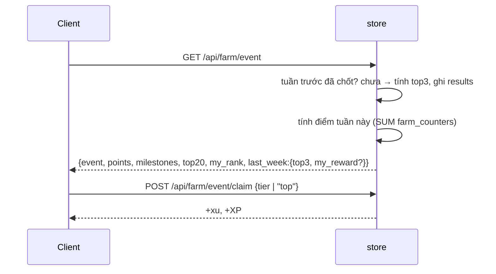

# Đặc tả kỹ thuật (SPEC): Nông trại — Sự kiện tuần & Bảng xếp hạng

Tài liệu này mô tả **sự kiện xoay vòng theo tuần**, gồm điểm sự kiện, mốc thưởng cá nhân và thưởng top 3,
cùng **bảng xếp hạng nông trại**.

---

## 1. Mục tiêu & Phạm vi

### 1.1. Bối cảnh
- Nhiệm vụ hằng ngày là mục tiêu ngắn hạn, thành tích là mục tiêu cả đời. Ở giữa chưa có nhịp tuần,
  và chưa có gì để **so tài** giữa bạn bè trong nông trại.
- Các game cờ đã có bảng xếp hạng (`SOLO_GAMES_RATING_SPEC.md`), nông trại thì chưa.

### 1.2. Mục tiêu chính
- [ ] Mỗi tuần (thứ Hai 0h đến Chủ nhật 24h, giờ VN) có **một sự kiện** chọn xoay vòng từ danh mục. Mỗi
  sự kiện chấm điểm một nhóm hành động.
- [ ] **Mốc cá nhân**: 3 mốc điểm, đạt mốc nào thì bấm nhận thưởng mốc đó.
- [ ] **Bảng xếp hạng sự kiện**: top 20 cùng hạng của mình. Hết tuần, **top 3** nhận thưởng.
- [ ] **Bảng xếp hạng thường trực**: theo cấp và theo xu kiếm được từ nông trại trong tuần.

### 1.3. Ngoài phạm vi / anti-goal
- Không làm sự kiện do admin tự cấu hình qua UI. Danh mục nằm trong code.
- Không có phần thưởng vật phẩm hiếm. Thưởng chỉ có xu và XP.
- **Anti-goal:**
  - Điểm sự kiện kiếm được bằng cách mua ở chợ rồi làm lại vô hạn. Chỉ chấm các hành động tốn thời
    gian sản xuất hoặc đã bị giới hạn theo ngày.
  - Tốn job nền nặng. Điểm tính từ `farm_counters` có sẵn, chốt tuần làm **lười**.

---

## 2. Kiến trúc & Luồng hoạt động

- **Điểm sự kiện không cần bảng mới:**
  `points(user, week) = Σ weight[k] × Σ_{day ∈ week} farm_counters(user, day, k)`.
  `farm_counters` đã đếm theo ngày cho mọi khoá bump.
- Các khoá bump mới (craft, fruit, order, feed) do spec thành tích thêm vào. Nếu spec sự kiện làm
  trước thì tự thêm.
- **Sự kiện của tuần:** `EventFor(weekIndex) = Events[weekIndex % len(Events)]`. Tính ra được, không
  cần lưu.
- **Chốt tuần lười:** lần đầu ai đó mở bảng sự kiện **sau khi tuần trước kết thúc**, server tính top 3
  của tuần trước rồi ghi vào `farm_event_results`. Một giao dịch, `INSERT OR IGNORE` theo khoá
  `(week, rank)` nên chạy song song vẫn an toàn. Người thắng tự bấm nhận thưởng.



---

## 3. Mô hình dữ liệu & API

### 3.1. SQLite (migration `000037_farm_events`)
```sql
CREATE TABLE farm_event_claims (
  user_id INTEGER NOT NULL REFERENCES users (id) ON DELETE CASCADE,
  week    TEXT    NOT NULL,           -- ISO "2026-W48"
  tier    INTEGER NOT NULL,           -- 1..3 mốc cá nhân, 0 = thưởng top
  PRIMARY KEY (user_id, week, tier)
);
CREATE TABLE farm_event_results (
  week    TEXT    NOT NULL,
  rank    INTEGER NOT NULL,           -- 1..3
  user_id INTEGER NOT NULL REFERENCES users (id) ON DELETE CASCADE,
  points  INTEGER NOT NULL,
  PRIMARY KEY (week, rank)
);
CREATE INDEX farm_counters_day_key ON farm_counters (day, key);  -- nếu chưa có, để tính tổng nhanh
```

### 3.2. Danh mục sự kiện (`Events`)
| id | Tên | Điểm (khoá × trọng số) |
|---|---|---|
| `duoc_mua` | 🌾 Tuần lễ được mùa | harvest × 1, plant × 0 |
| `nuoc_ep` | 🧃 Tuần lễ nước ép | craft (chỉ món của máy ép) × 5, fruit × 1 |
| `chan_nuoi` | 🐄 Tuần lễ chăn nuôi | feed × 2 |
| `xom_lang` | 🤝 Tuần lễ xóm làng | water × 3, bug × 3, visit × 1 |
| `giao_hang` | 🚚 Tuần lễ giao hàng | order × 10 |

- `craft` của máy ép cần khoá riêng `craft_juicer`, bump khi thu một món ép.
- `water` và `bug` chỉ tính khi giúp hàng xóm. Đây đã là luật bump hiện có, chủ tự làm không bump `water`.
  `bug` thì chủ tự bắt vẫn bump; với sự kiện `xom_lang` thì dùng khoá mới `bug_help`, chỉ bump khi giúp người khác.
- **Mốc cá nhân:** điểm mốc khác nhau theo sự kiện, khai báo trong danh mục, khoảng 1–2 / 3–5 / 7–10 ngày
  chơi đều. Thưởng: 🥉 150 xu + 30 XP, 🥈 400 xu + 80 XP, 🥇 1 000 xu + 200 XP.
- **Thưởng top tuần:** hạng 1 được 3 000 xu, hạng 2 được 2 000 xu, hạng 3 được 1 000 xu, ai cũng +300 XP.
  Phải có ≥ 3 người đạt ít nhất mốc 🥉 thì mới trao top 3, để tránh thắng khi không có đối thủ.

### 3.3. REST
```
GET  /api/farm/event                       -> EventView
POST /api/farm/event/claim  {tier: 1|2|3|"top", week?}  -> FarmView
GET  /api/farm/leaderboard?by=level|earn_week           -> {rows: {user, value, rank}[], me}
```
```ts
type EventView = {
  week: string; ends_at: string;
  event: { id: string; name: string; rules: { key: string; label: string; weight: number }[] };
  points: number; milestones: { tier: number; need: number; reward: number; claimed: boolean }[];
  top: { user: PublicUser; points: number; rank: number }[];   // top 20
  my_rank: number | null;
  last_week?: { event_name: string; top3: { user: PublicUser; points: number; rank: number }[];
                my_rank?: number; my_reward?: number; claimed?: boolean };
  next_event: { id: string; name: string };
};
```
`FarmView` thêm `event_badge?: {name, points, claimable: boolean}` để hiện chấm báo trên tab.

---

## 4. Quy tắc nghiệp vụ & Trường hợp biên

| Tình huống | Xử lý |
|---|---|
| Hoà điểm | Ai đạt điểm đó sớm hơn xếp trên, so theo ngày cuối có điểm. Nếu vẫn hoà thì so `user_id` nhỏ hơn. Ghi rõ trong UI "hoà: ai đạt trước xếp trên" |
| Không đủ 3 người đạt mốc 🥉 | Không trao thưởng top. `last_week` hiện "Tuần trước chưa đủ người tham gia" |
| Nhận thưởng mốc của tuần trước | Được, trong vòng 7 ngày sau khi tuần đó kết thúc (cho người quên bấm). Sau đó thì hết hạn |
| Nhận thưởng top hai lần | Khoá chính `(user, week, 0)` chặn |
| Người dùng bị xoá | `ON DELETE CASCADE`. Hạng đã chốt bị xoá, không dồn hạng |
| `/auto`, người làm thuê | Có tính điểm, vì vẫn là sản xuất thật và tốn xu thuê |
| Trộm (`steal`) | Không có sự kiện trộm, để không khuyến khích phá vườn người khác |
| Hiệu năng | Mỗi lần mở là một truy vấn `SUM … GROUP BY user_id` trên tối đa 7 ngày. Cache kết quả top 20 trong bộ nhớ 60 giây |
| `earn_week` | Tổng `farm_counters.earn` trong tuần (xu bán nông sản) |

---

## 5. Thiết kế giao diện

- **Tab mới "📅 Sự kiện"**:
  ```
  🧃 Tuần lễ nước ép            Còn 3 ngày 4 giờ
  Điểm: 🧃 ép nước ×5, 🍊 hái quả ×1
  Điểm của bạn: 236   ████████░░░  🥉 120 ✅ [Nhận]  🥈 300  🥇 700
  ── Bảng xếp hạng ──
  1. 🥇 Lan        512
  2. 🥈 Minh       430
  3. 🥉 Bạn        236
  …
  Tuần sau: 🐄 Tuần lễ chăn nuôi
  ```
- Đầu tuần mới, nếu `last_week.my_reward`, hiện hộp thoại "🏆 Tuần trước bạn hạng 2! +2 000 xu" kèm nút Nhận.
- Banner nông trại có huy hiệu nhỏ "🧃 236 điểm". Có chấm đỏ khi có thưởng nhận được.
- Bảng xếp hạng thường trực nằm trong tab Sự kiện, có 2 tab con: "Cấp" và "Xu tuần này".

---

## 6. Thống kê / Bảng xếp hạng

- Nguồn dữ liệu: `farm_counters` (theo ngày) và cấp trong bảng farm.
- Cách hiển thị và phân trang theo `SOLO_GAMES_RATING_SPEC.md`: top 20 và hạng của mình.

---

## 7. Kế hoạch triển khai

- [ ] Thêm các khoá bump `craft_juicer`, `bug_help` (và craft, fruit, order, feed nếu spec thành tích chưa làm).
- [ ] Migration `000037` cùng index, test.
- [ ] Store:
  - [ ] danh mục sự kiện, `EventFor(week)`;
  - [ ] tính điểm, mốc, nhận thưởng mốc (gồm tuần trước trong 7 ngày);
  - [ ] chốt top 3 lười, nhận thưởng top, điều kiện ≥ 3 người;
  - [ ] xử lý hoà;
  - [ ] bảng xếp hạng level / earn_week;
  - [ ] test, gồm chạy chốt song song.
- [ ] Controller: route, cache top 20 trong 60 giây, test.
- [ ] Desktop:
  - [ ] tab Sự kiện;
  - [ ] hộp thoại thưởng tuần trước;
  - [ ] huy hiệu trên banner;
  - [ ] bảng xếp hạng thường trực.
- [ ] Cập nhật `specs/FARM_SPEC.md` (§19), `specs/README.md`.
